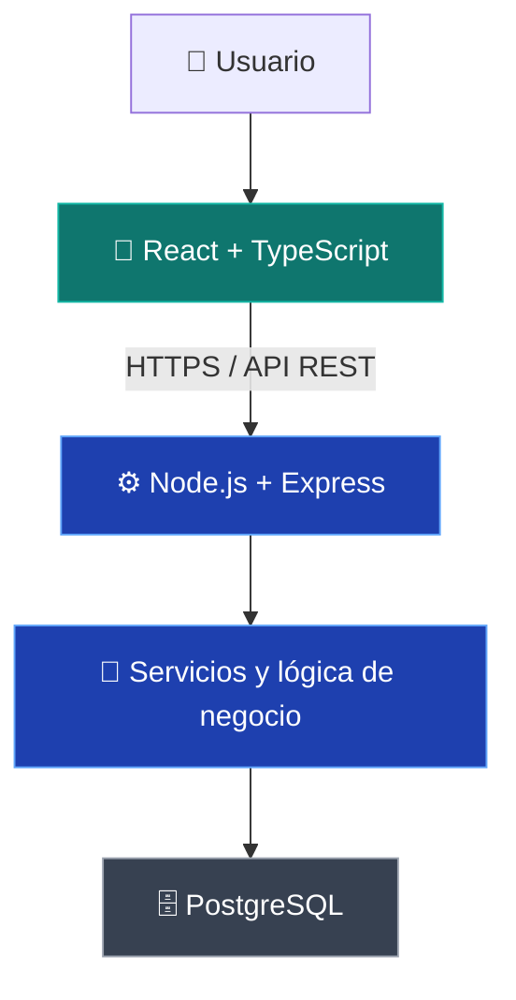

 <div align="center">

# 💸 ContaGo

### FINANZAS INTELIGENTES PARA NEGOCIOS QUE QUIEREN CRECER

**Su negocio. Sus números. Su tranquilidad.**

Una propuesta de plataforma financiera diseñada para ayudar a pequeños negocios y emprendedores a organizar su dinero, comprender sus movimientos y tomar decisiones con mayor claridad.


<br>

[**🚀 Conocer el proyecto**](#-qué-es-contago) · [**✨ Funcionalidades**](#-qué-ofrecerá-contago) · [**🛠️ Tecnologías**](#️-stack-tecnológico) · [**🗺️ Roadmap**](#️-hoja-de-ruta) · [**👨‍💻 Autor**](#-creado-por)

---

### 💡 «Los grandes negocios comienzan con pequeñas decisiones bien tomadas».

</div>

## 🚀 ¿Qué es ContaGo?

**ContaGo** es una iniciativa de desarrollo de software enfocada en crear una plataforma web para la organización y gestión financiera de pequeños negocios.

El proyecto nace de una necesidad cotidiana: muchos emprendedores trabajan constantemente para hacer crecer sus negocios, pero no siempre cuentan con herramientas sencillas para organizar sus ingresos, gastos y operaciones.

**Nuestra propuesta es transformar esa información en claridad.**

ContaGo busca reunir las operaciones financieras de un negocio en un mismo lugar, mediante una experiencia intuitiva y herramientas que ayuden a comprender cómo se mueve el dinero.

> 🎯 **Nuestra misión:** Hacer que la organización financiera sea más accesible, sencilla y comprensible para pequeños negocios y emprendedores.

---

## 🎯 El problema que queremos resolver

Imagine administrar un negocio donde:

- Los ingresos se registran en diferentes cuadernos.
- Los gastos se mezclan con otras operaciones.
- La información está distribuida en múltiples archivos.
- Consultar movimientos anteriores requiere demasiado tiempo.
- Las decisiones se toman sin una visión clara del comportamiento financiero.

Esta situación puede dificultar la organización y el crecimiento del negocio.

### 💚 Nuestra respuesta: ContaGo

Una propuesta de plataforma centralizada para registrar, organizar y consultar información financiera de manera sencilla.

| Sin una organización centralizada | Con la propuesta ContaGo |
|---|---|
| 📝 Registros dispersos | 📂 Información organizada |
| ❓ Dificultad para conocer los gastos | 💸 Seguimiento de egresos |
| 📚 Consultas manuales | 🔎 Historial consultable |
| 📉 Información difícil de interpretar | 📊 Indicadores y reportes |
| ⏳ Tiempo dedicado a ordenar registros | ⚡ Procesos más sencillos |

*Los beneficios descritos representan los objetivos del producto y deberán validarse cuando exista una versión disponible para usuarios.*

---

## ✨ ¿Qué ofrecerá ContaGo?

La plataforma se proyecta alrededor de módulos que responden a necesidades frecuentes de pequeños negocios.

### 📊 01 — Dashboard financiero

Un espacio para consultar información relevante del negocio de forma organizada.

**Capacidades previstas:**
- Resumen de ingresos y gastos.
- Indicadores financieros.
- Consulta rápida de movimientos.
- Información presentada mediante componentes visuales.

### 💵 02 — Gestión de ingresos

Herramientas para registrar y consultar entradas de dinero.

**Capacidades previstas:**
- Registro de ingresos.
- Consulta del historial.
- Clasificación de operaciones.
- Seguimiento de movimientos.

### 💸 03 — Control de gastos

Organización de las salidas de dinero del negocio.

**Capacidades previstas:**
- Registro de egresos.
- Clasificación por categorías.
- Consulta y seguimiento.
- Información para analizar gastos.

### 🗂️ 04 — Categorías personalizadas

Organización de movimientos financieros para facilitar su consulta.

**Capacidades previstas:**
- Creación de categorías.
- Clasificación de ingresos y egresos.
- Administración de registros.
- Organización de información financiera.

### 📈 05 — Reportes

Información estructurada para apoyar decisiones administrativas.

**Capacidades previstas:**
- Consulta de información histórica.
- Resúmenes financieros.
- Análisis de movimientos.
- Exportación de reportes según las capacidades de cada versión.

### 🔐 06 — Usuarios y seguridad

Controles orientados a proteger la información del negocio.

**Objetivos técnicos:**
- Autenticación de usuarios.
- Autorización y control de acceso.
- Validación de operaciones.
- Protección de información sensible.

> **Estado funcional:** Estas capacidades forman parte del alcance trabajado y proyectado para ContaGo. Su descripción no implica que estén disponibles actualmente en una versión pública ejecutable.

---

## 👥 ¿Para quién estamos construyendo ContaGo?

<div align="center">

| 🏪 Comerciantes | 🛍️ Emprendedores | 🍽️ Negocios de comida | 💼 Independientes |
|---|---|---|---|
| Organización diaria de ingresos y gastos | Seguimiento financiero del emprendimiento | Control de movimientos económicos | Registro estructurado de operaciones |
| Consulta de información | Mayor claridad financiera | Clasificación de gastos | Historial de movimientos |

</div>

**No necesita administrar una gran empresa para merecer herramientas que le ayuden a organizar su negocio.**

---

## 🛠️ Stack tecnológico

ContaGo busca evolucionar hacia una arquitectura moderna, modular y portable, priorizando tecnologías de código abierto y evitando dependencias obligatorias de un proveedor de infraestructura.

### 🚀 Arquitectura objetivo

<div align="center">

| Capa | Tecnología | Responsabilidad |
|---|---|---|
| 🎨 Frontend | **React + TypeScript + Vite** | Interfaz de usuario |
| ⚙️ Backend | **Node.js + Express + TypeScript** | API REST y lógica de negocio |
| 🗄️ Base de datos | **PostgreSQL** | Almacenamiento relacional |
| ✅ Validaciones | **Zod (propuesto)** | Validación de datos |
| 🧪 Pruebas | **Vitest (propuesto)** | Pruebas automatizadas |
| 🐧 Infraestructura | **Linux + contenedores OCI (propuesto)** | Despliegue portable |

</div>

**Estado:** La arquitectura TypeScript, Node.js y PostgreSQL ha sido seleccionada como dirección de desarrollo. Algunas herramientas complementarias siguen pendientes de evaluación e implementación.

### 🏗️ Vista conceptual



*Diagrama de la arquitectura objetivo, no de un despliegue público actualmente operativo.*

### 🔄 Evolución tecnológica

Durante su proceso de desarrollo, ContaGo también ha explorado tecnologías del ecosistema Microsoft:

- C#.
- .NET / ASP.NET Core.
- Entity Framework Core.
- SQL Server.

Estas experiencias forman parte de la evolución técnica del proyecto.

**La decisión actual es desarrollar las próximas versiones alrededor de TypeScript, Node.js y PostgreSQL.**

Esto permitirá explorar una arquitectura multiplataforma, manteniendo la capacidad de utilizar diferentes proveedores de infraestructura.

---

## 🧩 Principios de ingeniería

Además de sus funcionalidades, ContaGo busca construirse sobre principios técnicos claros.

| Principio | Aplicación prevista |
|---|---|
| 🔐 Seguridad | Validación y autorización en el servidor |
| 🧱 Modularidad | Separación de responsabilidades |
| 🔄 Portabilidad | Despliegue independiente de un proveedor específico |
| 💾 Integridad | Operaciones financieras consistentes |
| 🧪 Calidad | Pruebas automatizadas y revisión de cambios |
| 📚 Documentación | Información técnica y funcional actualizada |
| 🚀 Evolución | Arquitectura preparada para crecimiento progresivo |

Para el manejo de información financiera, la integridad de los datos y el control de acceso serán prioridades fundamentales.

---

## 📂 Estado del repositorio

### 🔎 Situación actual

La rama principal pública contiene documentación del proyecto.

```text
ContaGo/
│
└── README.md
```

**Disponibilidad actual:**

- ✅ Repositorio público.
- ✅ Documentación general del producto.
- ✅ Definición de la dirección tecnológica.
- ⏳ Código fuente de la nueva arquitectura pendiente de publicación.
- ⏳ Versión ejecutable pública pendiente.
- ⏳ Demostración funcional pendiente.

> ⚠️ **Transparencia:** ContaGo aún no se presenta como una aplicación pública lista para gestionar información financiera real. Este repositorio documenta el propósito y la evolución del producto.

---

## 🗺️ Hoja de ruta

Nuestra visión es construir ContaGo progresivamente, priorizando estabilidad, utilidad y claridad.

### Fase 1 — Definición del producto

- [x] Identificar el problema y público objetivo.
- [x] Definir los módulos principales.
- [x] Seleccionar la arquitectura tecnológica objetivo.
- [ ] Consolidar los requerimientos funcionales.

### Fase 2 — Fundamentos técnicos

- [ ] Organizar el frontend y backend.
- [ ] Diseñar el modelo relacional de PostgreSQL.
- [ ] Implementar validaciones de entrada.
- [ ] Establecer autenticación y autorización.
- [ ] Configurar pruebas automatizadas.

### Fase 3 — Módulos financieros

- [ ] Implementar el dashboard.
- [ ] Desarrollar el registro de ingresos y gastos.
- [ ] Incorporar administración de categorías.
- [ ] Implementar consultas e historial.
- [ ] Desarrollar reportes financieros.

### Fase 4 — Calidad y lanzamiento

- [ ] Auditar aspectos de seguridad.
- [ ] Validar las operaciones financieras.
- [ ] Incorporar pruebas de integración.
- [ ] Crear una demostración visual.
- [ ] Documentar la instalación y ejecución.
- [ ] Preparar pruebas con pequeños negocios.

### Fase 5 — Evolución

- [ ] Recopilar comentarios de usuarios.
- [ ] Mejorar la experiencia de uso.
- [ ] Evaluar nuevas necesidades del negocio.
- [ ] Preparar futuras versiones comerciales.

---

## 🚀 Instalación y ejecución

La arquitectura seleccionada todavía no se encuentra publicada como una versión completa y ejecutable en este repositorio.

Cuando se incorpore una implementación funcional, esta sección incluirá:

- Requisitos de Node.js y PostgreSQL.
- Instalación de dependencias.
- Configuración de variables de entorno.
- Preparación de la base de datos.
- Ejecución del frontend y backend.
- Comandos de pruebas.
- Instrucciones de despliegue.

**No se ofrecen comandos de instalación que todavía no hayan sido verificados con una implementación pública.**

---

## 🤝 Queremos construir una herramienta útil

ContaGo busca responder a necesidades reales, no únicamente demostrar conocimientos técnicos.

Nos interesa conocer las dificultades que enfrentan pequeños negocios al controlar sus ingresos y gastos.

Las ideas y sugerencias relacionadas con la experiencia del usuario, la claridad de los reportes y la organización de movimientos pueden contribuir a orientar futuras decisiones del producto.

El repositorio puede utilizarse como punto de referencia para conocer la propuesta y su evolución.

---

## 👨‍💻 Creado por

<div align="center">

### Yurgen Andrey Velasco Rojas

**Software Developer in Training | SENA ADSO**

Apasionado por el desarrollo de software, la arquitectura de aplicaciones, las bases de datos y la construcción de soluciones tecnológicas.

Interesado en explorar diferentes ecosistemas y desarrollar productos con independencia tecnológica.

[](https://github.com/YurgenVelasco)

</div>

---

## ⚖️ Derechos de autor

**Copyright © 2026 Yurgen Andrey Velasco Rojas.**

ContaGo es un proyecto de desarrollo de software cuya distribución y futura comercialización están por definirse.

Actualmente no se ha publicado una licencia abierta para el repositorio.

La disponibilidad pública de esta documentación no implica una autorización general para reutilizar, distribuir o comercializar el software.

---

<div align="center">

# 💚 ContaGo

### Su negocio. Sus números. Su tranquilidad.

**Construyendo una forma más sencilla de comprender las finanzas de pequeños negocios.**


[⬆ Volver al inicio](#-contago)

</div>
