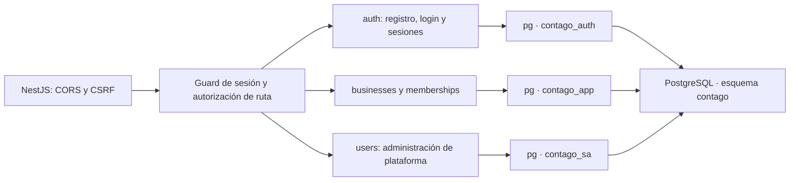

# Arquitectura del backend

- `config` valida los tres destinos y exige identidades distintas para la misma base. Su salida evita revelar el valor de una variable inválida.
- `database` administra un pool por identidad configurada. Verifica el conjunto exacto de funciones de cada grupo y la ausencia de permisos directos sobre tablas del esquema al arrancar. Las consultas usan SQL fijo con parámetros y conexiones `READ COMMITTED`.
- `auth` resuelve sesiones mediante hashes de tokens y expone el actor verificado a los módulos. Cada controlador declara si su política requiere sesión. Una ruta sin política explícita se deniega.
- `businesses` y `memberships` usan guards de rol local. `users` comprueba el rol global SA y usa únicamente la conexión administrativa. Las funciones PostgreSQL vuelven a verificar las reglas de negocio.
- `health` comprueba disponibilidad del proceso y de los pools configurados. Las respuestas de salud omiten detalles del servidor. La comprobación completa de privilegios ocurre al arrancar.

Las migraciones SQL se ejecutan por separado con el propietario del esquema. Prisma sigue siendo una herramienta de inspección. Consulte [el contrato HTTP y la matriz de permisos](seguridad.md) y [la guía de activación y pruebas](../README.md).

