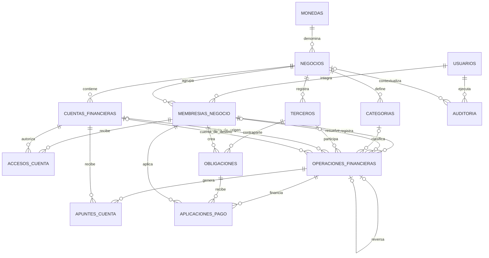

# Modelo relacional

| Tabla | Responsabilidad |
|---|---|
| `monedas` | Códigos monetarios y nombres. El catálogo inicial contiene COP. |
| `usuarios` | Identidad, hash y estado administrativo global. |
| `negocios` | Identidad, moneda y estado administrativo independiente. |
| `membresias_negocio` | Usuario, negocio, rol local y vigencia del acceso. |
| `categorias` | Clasificación local de ingresos o gastos. |
| `terceros` | Contrapartes locales de operaciones y obligaciones. |
| `cuentas_financieras` | Cajas y otras cuentas de un negocio. |
| `accesos_cuenta` | Permisos individuales de miembros sobre cuentas. |
| `operaciones_financieras` | Cabecera, importe, estado y resolución de cada movimiento. |
| `apuntes_cuenta` | Eventos inmutables con variaciones firmadas por cuenta. |
| `obligaciones` | Importe original de cuentas por cobrar y pagar. |
| `aplicaciones_pago` | Asignación de un importe de una operación a una obligación. |
| `auditoria` | Actor, instante y referencia a acciones administrativas y financieras. |

Las entidades financieras usan el negocio como parte de sus claves. Por ejemplo, una aplicación apunta a una operación y a una obligación mediante dos referencias que comparten `negocio_id`. Identificadores iguales en negocios distintos pueden existir y sus filas siguen aisladas. Las membresías históricas conservan la atribución aunque se revoque su acceso.

